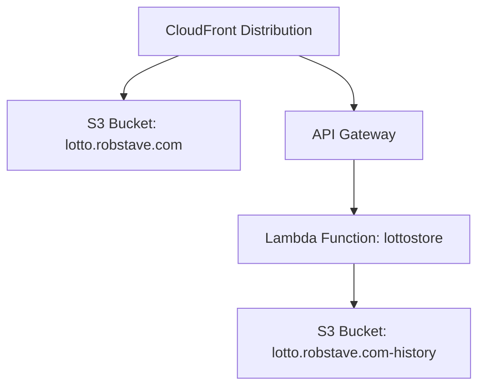

# Deployment Guide

This repository is deployed as a static site on AWS. The frontend is hosted in an S3 bucket, and a Lambda-backed API is used to save generated results to a second S3 bucket. CloudFront can sit in front of the static site and API for caching and delivery.

## Architecture at a glance

- `frontend/` is the public website content
- `lotto.robstave.com` is the S3 bucket that hosts the site
- `lotto.robstave.com-history` stores generated result history
- `lottostore` is the Lambda function that writes to the history bucket
- API Gateway exposes the Lambda to the browser
- CloudFront is used to cache and serve the site and API traffic



## Deployment model

This project does not use a traditional application server. The website is static HTML, CSS, and JavaScript, so deployment is simply a synchronization step:

1. Push code to the repository.
2. The deploy workflow runs.
3. It syncs the `frontend/` directory to the site S3 bucket.
4. It sets cache headers for different file types.
5. It invalidates CloudFront so users receive the latest content promptly.

The normal deployment flow is driven by GitHub Actions on the `main` branch.

## GitHub Actions deployment workflow

The frontend deployment workflow is defined in `.github/workflows/deploy.yml`.

It is configured to run when:
- a push happens to `main`
- and a file under `frontend/**` changes

That means the website deploy is tied to the `main` branch, not arbitrary feature branches.

### What the workflow does

1. Checks out the repository
2. Configures AWS credentials from GitHub secrets
3. Syncs `frontend/` to the S3 bucket
4. Applies different cache-control headers for HTML/JS/CSS versus other assets
5. Creates a CloudFront invalidation for `/*`

This ensures new pages and code are visible quickly without leaving stale cache behind.

## Lambda deployment workflow

The Lambda deployment workflow is in `.github/workflows/lambda-deploy.yml`.

This workflow is currently configured as a manual trigger (`workflow_dispatch`). It packages the `storePick` function and updates the Lambda code in AWS.

The auto-push trigger is commented out, so it does not automatically deploy on every branch push unless you uncomment it.

## Actual Lambda deployment steps

This project deploys the Lambda by zipping the function directory and updating the existing AWS Lambda function code.

From the repository root:

```bash
cd aws/lambda/functions/storePick
zip -r storePick.zip . -x "*.git*"
aws lambda update-function-code \
  --function-name "$LAMBDA_STORE_PICK_NAME" \
  --zip-file fileb://storePick.zip
```

If you want to do it from the repo root without changing directories:

```bash
zip -r aws/lambda/functions/storePick/storePick.zip aws/lambda/functions/storePick -x "*.git*"
aws lambda update-function-code \
  --function-name "$LAMBDA_STORE_PICK_NAME" \
  --zip-file fileb://aws/lambda/functions/storePick/storePick.zip
```

This is the real deployment action for the backend: the zip file is uploaded to the configured Lambda function, and AWS replaces the code used by the function at runtime.

If the Lambda function does not already exist, create it first with the appropriate runtime and handler, for example:

```bash
aws lambda create-function \
  --function-name "$LAMBDA_STORE_PICK_NAME" \
  --runtime nodejs20.x \
  --role "$LAMBDA_EXECUTION_ROLE_ARN" \
  --handler index.handler \
  --zip-file fileb://aws/lambda/functions/storePick/storePick.zip
```

For this repo, the function is a single-file Node.js Lambda using `index.mjs`, so the build step is just packaging the directory and publishing the zip archive.

## Required GitHub secrets

Create these repository secrets in GitHub:

- `AWS_ACCESS_KEY_ID`
- `AWS_SECRET_ACCESS_KEY`
- `AWS_REGION`
- `S3_BUCKET`
- `CLOUDFRONT_DISTRIBUTION_ID`
- `LAMBDA_STORE_PICK_NAME`

These values are needed so the workflows can authenticate to AWS and deploy to the right resources.

## Local deployment command

If you want to deploy manually from a machine with AWS CLI configured:

### Bash / macOS / Linux

```bash
aws s3 sync frontend/ s3://lotto.robstave.com --delete
```

### PowerShell

```powershell
aws s3 sync frontend/ s3://lotto.robstave.com --delete
```

The `--delete` flag ensures files removed locally are also removed from the bucket, keeping the deployed site aligned with source control.

## Cache behavior

The deployment sets cache headers so the site remains responsive without keeping stale assets forever:

- HTML, JS, and CSS: `max-age=300, must-revalidate`
- other assets: `max-age=3600`

This gives a short cache window for code files while allowing static images and other files to be cached longer.

## CloudFront invalidation

If the site does not reflect recent changes, the most common cause is stale CloudFront cache.

### Automatic invalidation
The deploy workflow creates an invalidation automatically after syncing to S3.

### Manual invalidation
If you need to clear the cache manually:

```bash
aws cloudfront create-invalidation \
  --distribution-id YOUR_DISTRIBUTION_ID \
  --paths "/*"
```

You can also do this in the AWS Console:
1. Open CloudFront
2. Select the distribution
3. Open the `Invalidations` tab
4. Click `Create Invalidation`
5. Set the path to `/*`
6. Create the invalidation

## Browser cache troubleshooting

Users may need a hard refresh to see the newest content:

- Windows/Linux: `Ctrl + Shift + R` or `Ctrl + F5`
- Mac: `Cmd + Shift + R`

## IAM permissions

A minimal deploy policy for the AWS user or role used by GitHub Actions or local deployment should allow reading and writing the site bucket.

```json
{
  "Version": "2012-10-17",
  "Statement": [
    {
      "Effect": "Allow",
      "Action": ["s3:ListBucket"],
      "Resource": "arn:aws:s3:::lotto.robstave.com"
    },
    {
      "Effect": "Allow",
      "Action": ["s3:PutObject", "s3:DeleteObject", "s3:PutObjectAcl"],
      "Resource": "arn:aws:s3:::lotto.robstave.com/*"
    }
  ]
}
```

If you also deploy the Lambda, the AWS identity used by GitHub Actions will need permission to update the Lambda function code and read its package artifacts.

## Deployment checklist

Before a production deployment, confirm:

- the GitHub secrets are set
- the S3 bucket exists and is configured for hosting or CloudFront delivery
- `main` is the branch you intend to deploy
- the CloudFront distribution ID is correct
- the Lambda function name is correct for the update workflow

Once those are in place, pushing to `main` will deploy the frontend and refresh the site for users.
