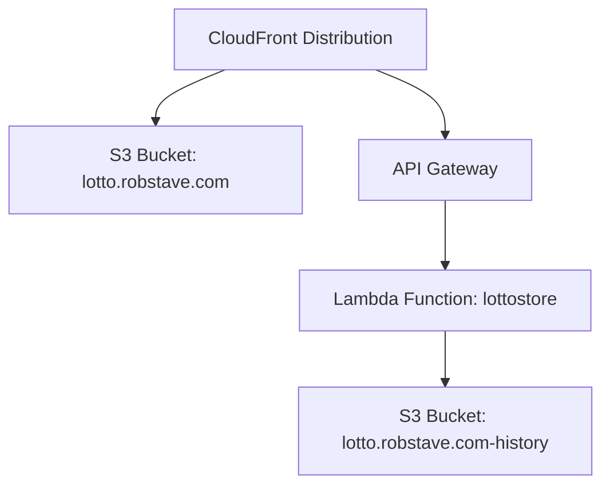

# lotto.robstave.com

A lightweight static site that generates California SuperLotto Plus numbers with a playful front end and a small AWS-backed history flow.

The app is primarily served from S3, with a Lambda-powered API used to store generated number sets in a separate history bucket. The site itself is static HTML, CSS, and JavaScript under the `frontend/` directory.

Live preview:
- https://s3.us-west-1.amazonaws.com/lotto.robstave.com/index.html
- lotto.robstave.com.s3-website-us-west-1.amazonaws.com

## Project architecture

- `frontend/` contains the static site files
- `aws/lambda/functions/storePick/` contains the Lambda code that stores results
- `lotto.robstave.com` is the public S3 bucket for the website
- `lotto.robstave.com-history` stores generated number history
- API Gateway exposes the Lambda endpoint to the web app
- CloudFront can sit in front of the site and API for caching and delivery

The API Gateway usage plan limits write requests to roughly 100 per day, and the API key is passed in the `x-api-key` header when invoking the API.

## Local development

- No build step is required.
- Open `frontend/index.html` directly in a browser for local testing.
- Optional: run a tiny local static server while editing to avoid browser caching issues.

## Deployment

Deployment is handled through the AWS and GitHub Actions setup described in [DEPLOYMENT.md](DEPLOYMENT.md).

In short:
- changes to the site are pushed to the repository
- the deploy workflow syncs `frontend/` to the S3 website bucket
- CloudFront cache is invalidated so the updated site appears promptly
- the Lambda deployment workflow publishes the backend function when needed

## GitHub Actions workflows

This repo includes three workflow files in `.github/workflows/`:

- `ci.yml` — validation checks for HTML and links
- `deploy.yml` — deploys the static frontend to S3 and clears CloudFront cache
- `lambda-deploy.yml` — deploys the Lambda function used by the history API

## Notes

The main page renders a star-polygon chord diagram beneath the generated SuperLotto numbers, and the project is intentionally lightweight and static by design.
